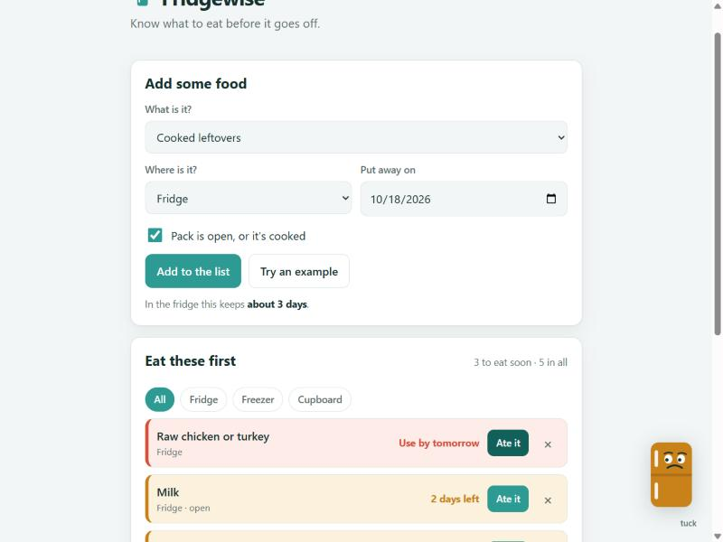

# Fridgewise

Know what to eat before it goes off.

Keep a quick list of what's in your fridge, freezer and cupboard. Fridgewise
works out roughly how long each thing keeps and sorts the list so the food you
need to use first sits at the top. Less guessing, less thrown away.



## Why

A UK household throws away about £700 of food a year, and most of it could have
been eaten ([WRAP, Food Surplus and Waste in the UK](https://www.wrap.ngo/resources/report/food-surplus-and-waste-uk-key-facts)).
A lot of that is losing track of what's in the fridge and finding it a few days
too late. Fridgewise is a one-screen list that keeps the order for you.

## How it works

- Pick a food, say where it is and when you put it away.
- Tick the box if the pack is open or the food is cooked, since that shortens
  how long it keeps.
- Your list shows up sorted, with the soonest at the top and a colour for how
  close each one is.
- Tap **Opened it** the day you open a sealed thing, and the clock jumps to its
  open shelf life counted from that day, which is often sooner than the pack
  date. Milk, for instance, keeps about a week sealed but only a few days once
  open.
- Tap **Thawed it** when you move something out of the freezer to defrost in
  the fridge, and the clock restarts on its fridge life from that day: a chicken
  that was good for months frozen now needs using in a day or two. This follows
  the USDA "Big Thaw" rule, that food thawed in the fridge keeps a day or two
  for mince, poultry and fish and a few days for other cuts, whatever the frozen
  date said.
- Tap **Ate it** when it's gone, or put something in the freezer to buy weeks
  more time.

Frost, the little fridge in the corner, keeps an eye on the list and nudges you
when something's close.

The list is saved in your own browser, so it's there next time.

## Keep times

The days each food keeps come from the US FoodSafety.gov
[Cold Food Storage Chart](https://www.foodsafety.gov/food-safety-charts/cold-food-storage-charts)
and the USDA FoodKeeper, using the shorter end of each range so the date leans
safe. They are a guide, not a promise: a pack's own use-by date wins, and if
something looks or smells off, bin it. The thawed-food window follows the USDA /
FoodSafety.gov [The Big Thaw](https://www.fsis.usda.gov/food-safety/safe-food-handling-and-preparation/food-safety-basics/big-thaw-safe-defrosting-methods)
guidance, which matches each food's fridge shelf life in the table above.

If a pack has a date printed on it, type it in and say whether it's a **use-by**
or a **best-before**. The pack date then overrides the stored-time guess, and
Fridgewise gives the right advice for each: a use-by is about safety, so once
it's passed the line is "don't eat it"; a best-before is about quality, so it's
usually fine after, just not at its best. That split follows the UK Food
Standards Agency's guidance on the two kinds of date.

## Run it

It's plain HTML, CSS and JavaScript with no build step. Open `index.html`, or
serve the folder:

```
python -m http.server 8000
```

## Tests

The keep-time and sorting logic lives in `src/engine.js` with no page code, so
the tests run the same functions the page does.

```
npm test
```

## Licence

MIT.
